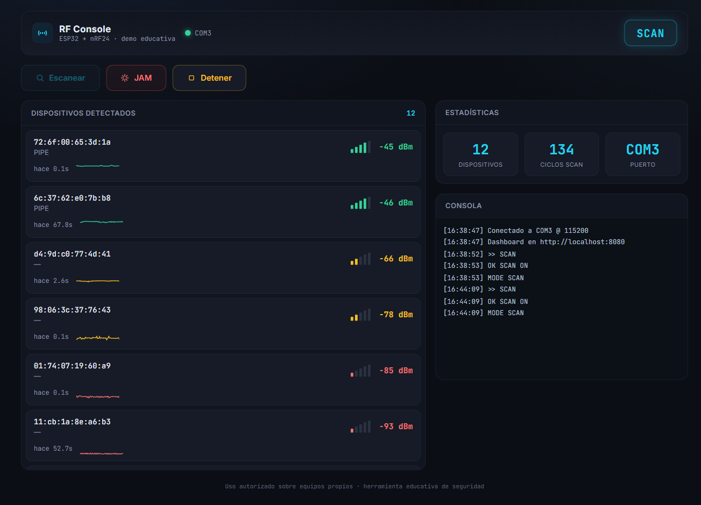
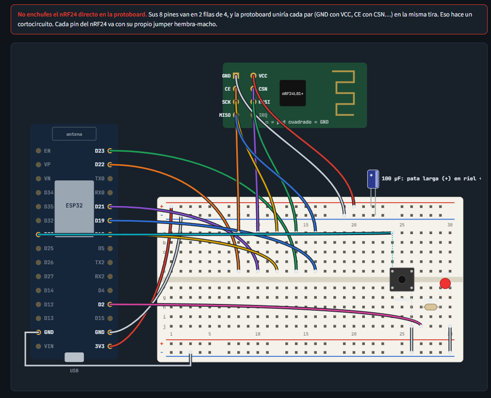

<p align="center">
  
</p>

<h1 align="center">RF Console</h1>

<p align="center">
  Laboratorio personal de seguridad RF en 2.4&nbsp;GHz: consola serial de radio,
  escáner BLE y dashboard web con clasificación de dispositivos.
  <br>Hardware ESP32 + nRF24L01+ PA/LNA. Proyecto educativo de <i>hacking ético</i>.
</p>

<p align="center">
  
  
  
  
  
  
</p>

---

> [!WARNING]
> **Uso responsable.** Este repositorio es un **registro de laboratorio personal** con
> fines educativos. La función de interferencia (*jamming*) emite una portadora continua
> en 2.4&nbsp;GHz: **operarla puede ser ilegal** y degrada Wi-Fi, BLE y otros servicios
> cercanos. Úsala **solo** sobre equipos propios, en un entorno aislado (jaula de Faraday
> o distancia controlada) y con autorización explícita. Quien lo ejecute es el único
> responsable del cumplimiento de la normativa local de espectro radioeléctrico.
>
> Antes de operar, seguí la **[guía de laboratorio seguro](docs/LABORATORIO.md)** y medí
> primero con el **monitor pasivo** (modo `MON`).

## ¿Qué es?

Un banco de pruebas de radiofrecuencia de 2.4&nbsp;GHz montado sobre un **ESP32** con un
transceptor **nRF24L01+ PA/LNA**. Expone tres piezas:

- **Firmware (`rf_console`)** — una consola serial que escanea anuncios BLE (dirección,
  RSSI y nombre), gestiona una portadora continua sobre tres canales BLE y hace un
  **barrido pasivo de espectro** (126 canales) con el detector de energía del nRF24.
- **Monitor de espectro** — el panel dibuja la ocupación por canal en 2.4&nbsp;GHz (modo `MON`),
  útil para *observar* el ambiente y tus propias pruebas sin irradiar.
- **Dashboard web** — un backend Python (`pyserial` → HTTP) y un frontend oscuro de una
  sola página que muestra los dispositivos detectados, su RSSI en vivo y permite enviar
  comandos al ESP32.
- **Herramienta de escaneo (`ble_scan.py`)** — escaneo BLE independiente desde el PC con
  `bleak`, útil para contrastar lo que ve el ESP32.

<p align="center">
  
</p>

## Estructura

```
firmware/
  rf_console/rf_console.ino   consola serial: SCAN / JAM / STOP vía USB o botón GPIO 33
  jammer_ble/jammer_ble.ino   sketch previo: portadora controlada solo por botón
dashboard/
  server.py                   backend: lee el serial y sirve la API/HTTP en localhost
  static/index.html           frontend de una sola página (sin build, sin frameworks)
tools/
  ble_scan.py                 escáner BLE de escritorio (bleak)
docs/
  BRIEF_DASHBOARD.md          brief original del dashboard
  MONTAJE.md                  guía de montaje y cableado paso a paso
  INFORME.md                  por qué el jam no afecta a audífonos Bluetooth
  LABORATORIO.md              guía de laboratorio seguro (uso responsable)
  conexion_esp32_nrf24.svg    esquema de conexión ESP32 ↔ nRF24
  montaje_protoboard.svg      montaje en protoboard
  laboratorio.svg             diagrama de entorno controlado
  dashboard.png               captura del dashboard
  hero.svg                    banner animado
```

## Hardware y conexión

| nRF24L01+ | ESP32 (VSPI) |
|-----------|--------------|
| CE        | GPIO 22      |
| CSN       | GPIO 21      |
| SCK       | GPIO 18      |
| MOSI      | GPIO 23      |
| MISO      | GPIO 19      |
| VCC       | **3.3 V externos** (el módulo PA/LNA demanda picos de corriente altos) |
| GND       | GND          |

Además: **LED** de estado en GPIO 2 y **botón** (a GND, con `INPUT_PULLUP`) en GPIO 33.

> El esquema completo está en [`docs/conexion_esp32_nrf24.svg`](docs/conexion_esp32_nrf24.svg)
> y el montaje real en [`docs/montaje_foto.png`](docs/montaje_foto.png).
> Alimentá el nRF24 con 3.3 V estables (y un condensador de desacoplo); el pin de 3.3 V del
> ESP32 suele no dar suficiente corriente para la variante PA/LNA.

### Montaje en protoboard

<p align="center">
  
</p>

El ESP32 va **fuera** de la protoboard y se conecta con jumpers hembra-macho; el nRF24
**nunca** se enchufa directo (sus dos filas de pines quedarían puenteadas). Guía paso a paso
—cómo ubicar los 8 pines del módulo, la tabla completa de jumpers, el orden de armado y la
alimentación— en **[`docs/MONTAJE.md`](docs/MONTAJE.md)**.

## Puesta en marcha

### 1. Firmware

1. Abrí `firmware/rf_console/rf_console.ino` en el IDE de Arduino con el core de ESP32.
2. Instalá la librería **RF24** (TMRh20).
3. Seleccioná tu placa ESP32 y el puerto, y subí el sketch.

### 2. Dashboard

```bash
python -m pip install pyserial
# el puerto por defecto es COM3; cámbialo si hace falta:
set RF_PORT=COM3            # Windows (cmd)      — $env:RF_PORT="COM3" en PowerShell
python dashboard/server.py
```

Abrí <http://localhost:8080>. El servidor sólo escucha en `127.0.0.1`.
Variables de entorno opcionales: `RF_PORT`, `RF_WEB_PORT` (8080), `RF_DEV_TTL` (15 s).

### 3. Escáner de escritorio (opcional)

```bash
python -m pip install bleak
python tools/ble_scan.py
```

## Protocolo serial (115200 baudios)

Comandos que acepta el firmware (por USB o reenviados por el dashboard):

| Comando            | Efecto                                             |
|--------------------|----------------------------------------------------|
| `SCAN`             | inicia el escaneo BLE                              |
| `NOSCAN` / `SCANOFF` | detiene el escaneo                              |
| `MON` / `MONITOR`  | barrido pasivo de espectro (126 canales)           |
| `J` / `JAM`        | activa barrido continuo 2402–2480 MHz (canales 2–80) en todas las radios |
| `X` / `STOP`       | detiene jamming y escaneo                          |
| `S` / `STATUS`     | imprime el modo actual (`IDLE`/`SCAN`/`JAM`)      |
| `PING`             | responde `PONG`                                    |
| `H` / `HELP`       | lista los comandos                                 |

Salida relevante: `DEV <mac> <rssi> <nombre>` por cada anuncio BLE, `MODE <estado>`,
`SCANEND` al cerrar un ciclo de escaneo. El pulsador en GPIO 33 alterna el jamming sin PC.

## Modos y configuración de jamming

El firmware `rf_console` expone estas opciones en tiempo de compilación (defines al inicio de `rf_console.ino`):

| Define          | Valor por defecto | Descripción                                                                 |
|-----------------|-------------------|-----------------------------------------------------------------------------|
| `RADIO2_PINS`   | `0`               | `1` = habilita un 2º nRF24L01+ en bus HSPI (ver cableado abajo)            |
| `WIFI_JAM`      | `0`               | `1` = emite ruido wideband experimental con el WiFi del ESP32 (ver nota)   |
| `CH_SWEEP_LOW`  | `2`               | Canal nRF24 inicial del barrido (2 = 2402 MHz, límite bajo BT)             |
| `CH_SWEEP_HIGH` | `80`              | Canal nRF24 final del barrido (80 = 2480 MHz, límite alto BT)              |
| `PLL_DWELL_US`  | `150`             | µs de asentamiento del PLL tras cada salto de canal                        |

### Cableado 2º nRF24L01+ (HSPI)

| nRF24L01+ | ESP32 (HSPI) |
|-----------|--------------|
| CE        | GPIO 26      |
| CSN       | GPIO 27      |
| SCK       | GPIO 14      |
| MOSI      | GPIO 13      |
| MISO      | GPIO 12      |
| VCC       | 3.3 V externos |
| GND       | GND          |

> **Nota sobre `WIFI_JAM`**: es **experimental**. Usa `esp_wifi_80211_tx` para inyectar tramas 802.11 crudas en los canales 1, 6 y 11. La API (`wifi_ieee80211_pkt_t`, `esp_wifi_80211_tx`) puede variar según la versión del core ESP32 Arduino; si no compila, desactívalo (`#define WIFI_JAM 0`) o adapta el bloque `#if WIFI_JAM` al core instalado.

El sketch `jammer_ble` (solo botón, sin BLE ni serial) usa un barrido idéntico de 80 canales (2–80, `PLL_DWELL_US=150`) con una única radio; no expone `RADIO2_PINS` ni `WIFI_JAM`.

### API del dashboard

- `GET /api/state` → JSON con `connected`, `port`, `mode`, `devices[]` (con `rssi`,
  `age`, `history` y clasificación), `log[]`, `counters` y `ports[]`.
- `POST /api/command` con `{"cmd":"scan"|"jam"|"stop"}`.

El backend clasifica cada dispositivo por **nombre** (parlante, audífonos, celular…) y por
**OUI** de la MAC (Espressif, Apple, Samsung, Google…), marcando las MAC aleatorias.
Detalles del contrato en [`docs/BRIEF_DASHBOARD.md`](docs/BRIEF_DASHBOARD.md).

## Licencia

Distribuido bajo **GPL-3.0**. Ver [`LICENSE`](LICENSE).
