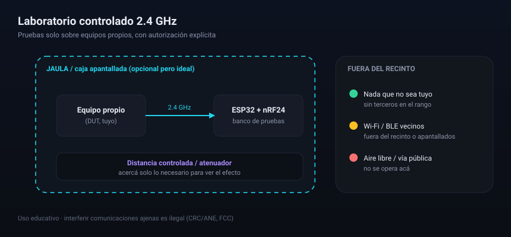

# Guía de laboratorio seguro (2.4 GHz)

  

Cómo montar y operar el banco de pruebas **sin salirte del marco legal** y sin dañar nada
que no sea tuyo.

> [!WARNING]
> Operar una portadora en 2.4&nbsp;GHz sobre equipos ajenos es **interferencia perjudicial** y
> está prohibido (Colombia: CRC/ANE; EE.UU.: FCC). Esta guía **no** reemplaza la normativa
> local: quien ejecuta es el único responsable.

## Principios

1. **Solo equipos propios** o con autorización explícita y por escrito.
2. **Entorno controlado**: jaula de Faraday / caja apantallada, o aislado y con la menor
   potencia y distancia posibles.
3. **Primero medir, después (si acaso) emitir.** El **monitor pasivo** (`MON`) te dice qué tan
   ocupado está el ambiente sin irradiar nada.
4. **Registrar** todo: MACs propias, modos usados, potencia, duración y resultado.

## Checklist antes de energizar

- [ ] USB **desconectado** mientras cableás.
- [ ] **GND** del nRF24 (pad cuadrado) verificado **antes** de VCC (ver [`MONTAJE.md`](MONTAJE.md)).
- [ ] nRF24 **no tolera 5&nbsp;V** en VCC → solo 3.3&nbsp;V.
- [ ] Condensador de **10–47&nbsp;µF** junto a VCC/GND del módulo (evita resets y falsos 0 en el RPD).
- [ ] Alimentación **lineal** (no conmutada) si el PA reinicia.
- [ ] Cada jumper revisado contra la tabla de [`MONTAJE.md`](MONTAJE.md).

## Entorno

- **Jaula de Faraday / caja apantallada**: contiene la emisión y evita alcanzar redes vecinas.
- **Sin jaula**: distancia y potencia mínimas, en un espacio aislado, y **nunca** en aire libre
  o vía pública.
- **Terceros fuera**: ningún dispositivo ajeno dentro del rango. Wi-Fi/BLE del vecindario
  también cuentan.

## Flujo de trabajo

1. **Medir**: `MON` → mirá el espectro/ocupación del ambiente.
2. **Detectar tus equipos**: `SCAN` con tus dispositivos, anotá sus MAC.
3. **Registrar**: guardá el estado (`/api/state`) y capturas del panel para el informe.
4. **Detener siempre** al terminar (`Detener` / `STOP`) y dejar el equipo en `IDLE`.

## Qué NO hacer

- No apuntar a dispositivos de terceros ni operar en espacios públicos.
- No dejar el modo `JAM` encendido "de fondo".
- No publicar capturas con MAC de terceros sin anonimizar.

## Referencias

- Registro de dispositivos y clasificación: `dashboard/server.py` (`OUI_VENDOR`, `NAME_TYPE`).
- Limitaciones de medición pasiva: [`INFORME.md`](INFORME.md) §8.
- Montaje y cableado: [`MONTAJE.md`](MONTAJE.md).
