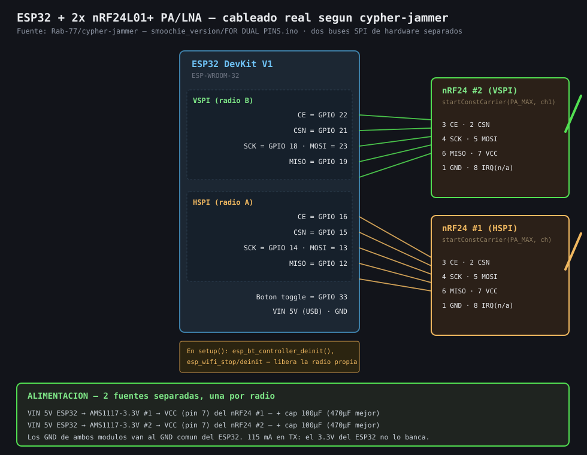
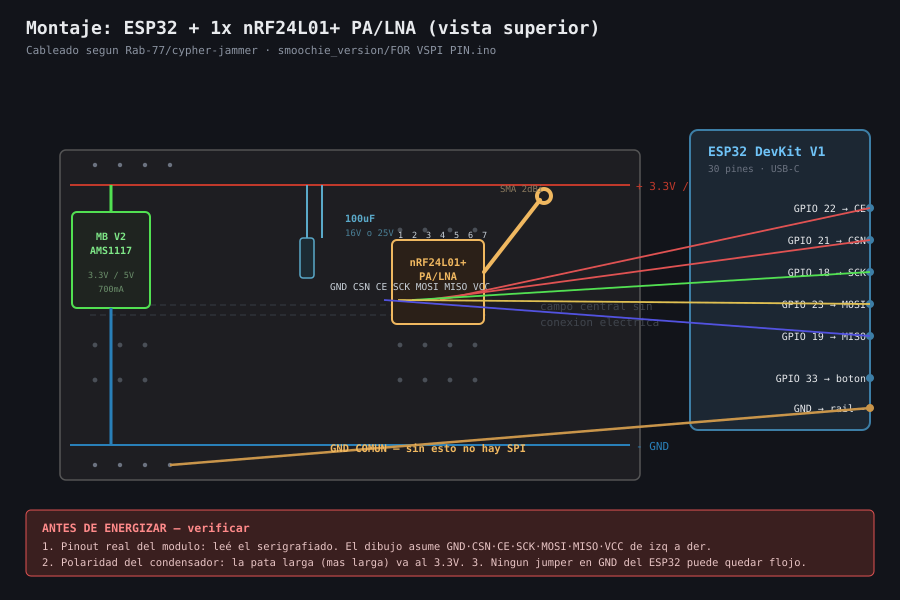

# Montaje y cableado — ESP32 + nRF24L01+

El **ESP32** queda fuera de la protoboard y sale con jumpers hembra-macho. Todo lo demás
—rieles de alimentación, condensador, botón y LED— vive en la protoboard. El **nRF24**
también entra con jumpers hembra-macho. Las letras y números de cada agujero son los que
trae impresos la protoboard.

  
   
  
   
  

> [!WARNING]
> **No enchufes el nRF24 directo en la protoboard.** Sus 8 pines van en 2 filas de 4, y la
> protoboard uniría cada par (GND con VCC, CE con CSN…) en la misma tira. Eso hace un
> **cortocircuito**. Cada pin del nRF24 va con su propio jumper hembra-macho.

## Encontrar los pines del nRF24

| # | Señal | # | Señal |
|:-:|:-----:|:-:|:-----:|
| 1 | **GND** | 5 | SCK |
| 2 | VCC | 6 | MOSI |
| 3 | CE | 7 | MISO |
| 4 | CSN | 8 | IRQ |

1. Dale vuelta al módulo y mirá las soldaduras. El pin con el pad **cuadrado** es el
   **1 — GND**.
2. Su vecino en la misma pareja es el **2 — VCC**.
3. Alejándote de esa pareja, cada fila de dos es: **CE / CSN**, después **SCK / MOSI** y al
   final **MISO / IRQ**. CE, SCK y MISO quedan en la columna del GND.
4. **IRQ** queda sin conectar.

> [!NOTE]
> Tu módulo es el **nRF24L01+ estándar** (antena dibujada en la placa). Si tiene **antena de
> rosca**, es el **PA+LNA**: mismos pines, pero consume más y casi seguro necesita la
> fuente MB V2.

## Dónde va cada jumper

| Señal | Desde (nRF24) | Hasta (ESP32 / protoboard) |
|:-----:|:-------------:|:--------------------------:|
| GND  | pin 1 | GND del ESP32 / riel − |
| VCC  | pin 2 | riel + (**3.3 V**) |
| CE   | pin 3 | **GPIO 22** |
| CSN  | pin 4 | **GPIO 21** |
| SCK  | pin 5 | **GPIO 18** |
| MOSI | pin 6 | **GPIO 23** |
| MISO | pin 7 | **GPIO 19** |
| IRQ  | pin 8 | — (sin conectar) |

Además: **LED** de estado en GPIO 2 y **botón** (a GND, con `INPUT_PULLUP`) en GPIO 33.

## Orden de armado

1. **USB desconectado.** Hacé todas las conexiones sin energía.
2. Verificá el **GND** del nRF24 (pad cuadrado) antes de conectar VCC.
3. Revisá cada jumper contra la tabla.
4. Recién ahí conectá el USB al ESP32.

## Alimentación

Arrancá con el **3V3 del ESP32** en el riel + de arriba, más el condensador de **100 µF**
entre los rieles, al lado de donde entran VCC y GND del nRF24. Si el Serial Monitor muestra
`FALLO` o el módulo se reinicia, alimentá el riel + con **3.3 V de la MB V2**, desconectá el
jumper 3V3 del ESP32 y dejá los GND unidos.

> [!CAUTION]
> El nRF24 **no tolera 5 V en VCC**.
